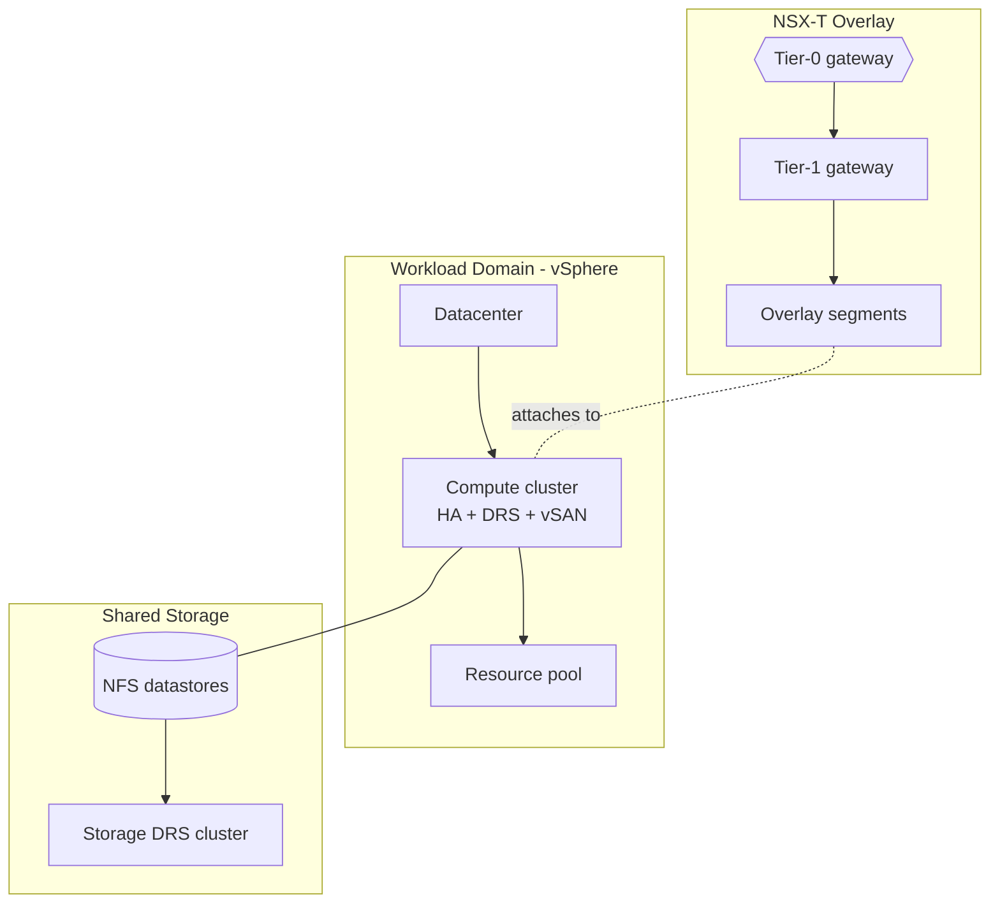

# VMware Cloud Foundation Platform (IaC)

[](LICENSE)
[](https://github.com/abhisheksawant52/vmware-vcf-platform/actions/workflows/ci.yml)
[](https://www.terraform.io/)
[](https://registry.terraform.io/providers/hashicorp/vsphere/latest)
[](https://registry.terraform.io/providers/vmware/nsxt/latest)

Terraform for a **VMware Cloud Foundation** workload domain: HA/DRS/vSAN compute
clusters on vSphere, NSX-T overlay networking, and Storage-DRS shared storage —
codified as reusable modules.

## Overview

VCF deployments standardize on the same building blocks: a workload domain
(compute cluster) with HA, DRS, and vSAN; NSX-T overlay networking fronted by
Tier-0/Tier-1 gateways; and shared datastores managed by Storage DRS. This
project expresses those blocks as Terraform against the `vsphere` and `nsxt`
providers.

It targets VMware platform engineers standing up or expanding a workload domain.
The root module composes three submodules — `workload-domain`, `nsx`, and
`storage` — parameterized per environment (`dev`, `prod`).

## Architecture



Components:

- **workload-domain** — looks up the datacenter and ESXi hosts, builds a
  compute cluster with vSphere HA (admission control), DRS (fully automated),
  and vSAN (dedup/compression), plus a resource pool and VM folder.
- **nsx** — Tier-0 gateway (active/standby) on the Edge cluster, a Tier-1
  gateway with route advertisement, and overlay segments per application tier.
- **storage** — NFS datastores mounted across the hosts and a Storage-DRS
  datastore cluster for automated placement and balancing.

## Features

- Declarative workload domain with HA, DRS, and vSAN toggles.
- NSX-T policy-mode networking (Tier-0/Tier-1 + segments).
- Storage DRS datastore cluster with I/O and space balancing.
- Secrets kept out of state files via `TF_VAR_*` / sensitive variables.
- Environment isolation with per-environment tfvars and remote state backends.

## Tech Stack

Terraform >= 1.5 · hashicorp/vsphere ~> 2.8 · vmware/nsxt ~> 3.7 · vCenter ·
NSX-T Policy API · vSAN · Storage DRS · GitHub Actions · TFLint

## Getting Started

### Prerequisites

- Terraform >= 1.5
- Reachable vCenter and NSX-T Manager endpoints with API credentials
- An existing NSX-T Edge cluster and overlay transport zone (referenced by path)

### Configure

```bash
cp terraform.tfvars.example terraform.tfvars
# Prefer environment variables for credentials:
export TF_VAR_vsphere_password='...'
export TF_VAR_nsx_password='...'
```

### Initialize & plan

```bash
terraform init -backend-config=environments/dev/backend.hcl
make fmt-check
make validate
make plan ENV=dev
```

## Project Structure

```
.
├── main.tf                      # composes the three submodules
├── variables.tf
├── outputs.tf
├── versions.tf                  # required_providers + backend (commented)
├── providers.tf                 # vsphere + nsxt providers
├── terraform.tfvars.example
├── modules/
│   ├── workload-domain/         # cluster (HA/DRS/vSAN), resource pool
│   ├── nsx/                     # Tier-0/Tier-1 gateways + segments
│   └── storage/                 # NFS datastores + Storage DRS
├── environments/
│   ├── dev/{terraform.tfvars,backend.hcl}
│   └── prod/{terraform.tfvars,backend.hcl}
└── .github/workflows/ci.yml     # fmt / validate / tflint
```

## Configuration

| Variable              | Description                                           |
| --------------------- | ----------------------------------------------------- |
| `vsphere_server`      | vCenter FQDN/IP.                                       |
| `vsphere_user` / `_password` | vCenter credentials (password is sensitive).   |
| `nsx_manager_host`    | NSX-T Manager FQDN/IP.                                 |
| `nsx_username` / `_password` | NSX-T credentials (password is sensitive).     |
| `datacenter`          | vSphere datacenter name.                              |
| `workload_domain`     | Cluster name, hosts, and HA/DRS/vSAN toggles.         |
| `edge_cluster_path`   | NSX-T Edge cluster policy path.                       |
| `transport_zone_path` | Overlay transport zone policy path.                   |
| `segments`            | Overlay segments keyed by name.                       |
| `datastores`          | NFS datastores keyed by name.                         |

## Deployment

Each environment has its own state backend and variables:

```bash
terraform init -backend-config=environments/prod/backend.hcl
terraform plan -var-file=environments/prod/terraform.tfvars
```

## Contributing

Contributions are welcome — see [CONTRIBUTING.md](CONTRIBUTING.md) and our
[Code of Conduct](CODE_OF_CONDUCT.md).

## Security

Please report vulnerabilities as described in [SECURITY.md](SECURITY.md).

## License

Released under the [MIT License](LICENSE).
